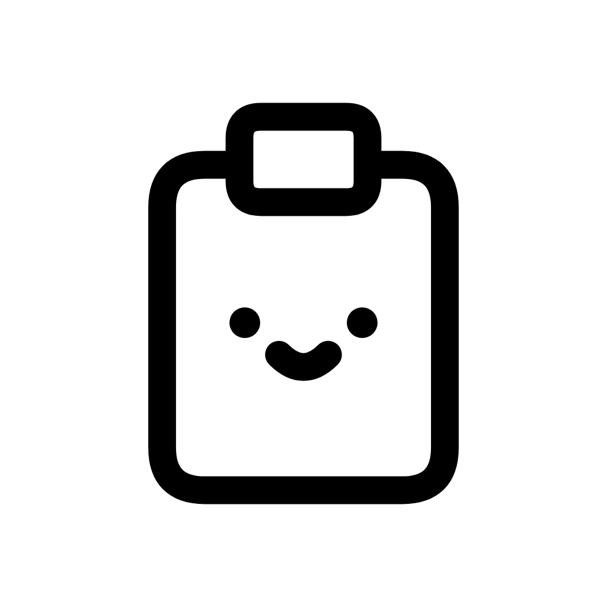

# heiccy



[한국어](README.md) · [English](README.en.md)


[](LICENSE)

> HEIC to JPEG or PNG, automatically.

**heiccy** is a macOS menu bar app that converts copied HEIC images into JPEG or
PNG, ready to paste with **Command-V**. Copy a supported photo in Photos or a
HEIC file in Finder. Images are processed on your computer and source files
remain unchanged.

Both the app and its conversion engine are written in Swift and use native
macOS image APIs. The app bundles no Python runtime or external codecs, and you
do not need to install them separately.

**Release status:** Version 1.0.0 is being prepared. The official download entry
point is [heiccy Releases](https://github.com/jaehunshin-git/heiccy/releases).
A DMG is available only after its release has been published.

## Features

| Feature | Description |
| --- | --- |
| Automatic conversion after copying | Copy a supported HEIC photo in Photos or a local HEIC file in Finder, then paste after conversion completes. |
| JPEG and PNG output | Choose JPEG quality and PNG compression; supported photos can produce 16-bit HDR PNG. |
| Metadata policies | Remove GPS and XMP by default, retain original metadata, or remove EXIF and XMP. |
| Local processing | No photo uploads, source-file changes, or clipboard history. |

## Technology stack

| Category | Technology |
| --- | --- |
| App | Swift, SwiftUI, AppKit |
| Conversion | macOS Image I/O, Core Image |
| Compression | macOS system zlib |

## macOS app installation

### Requirements

- Apple Silicon Mac (arm64), macOS 15 or later
- No Python, Pillow, or additional codec installation required

### DMG download and installation

The app's distribution destination is
[GitHub Releases](https://github.com/jaehunshin-git/heiccy/releases).
Download the DMG and checksum from the same published release. Until that
release is available, these steps apply to a build made from source:

1. Obtain the DMG and its matching `.sha256` file from the same build or
   release.
2. In the directory containing both files, verify the checksum:

   ```bash
   shasum -a 256 -c heiccy-1.0.0-arm64.dmg.sha256
   ```

3. Open the DMG and drag **heiccy.app** to **Applications**.
4. Open **heiccy** from Applications; its icon appears in the menu bar.

Current builds use ad-hoc signing and are not notarized. If macOS blocks the
first launch, follow [Apple's instructions](https://support.apple.com/102445).

### Replacing an earlier app build

The new filename does not replace an existing `HEIC Converter.app`
automatically. Quit the earlier app from its menu bar menu before installing
`heiccy.app`, so it can restore any clipboard data it published. Keep the earlier
bundle outside Applications as a backup, then install and open `heiccy.app`
explicitly. Do not run both copies together. If you return to the earlier build,
quit heiccy first.

The bundle identifier and settings key are unchanged, so saved conversion
options and legacy output paths remain available. Pause is session-only;
automatic conversion starts enabled on the next launch.

### Build the app from source

See the [app build and release guide](docs/build.md) (in Korean) to build from
source.

## Using heiccy

1. Copy a supported HEIC photo directly from Photos or a local HEIC file in
   Finder. Supported Photos input needs no export.
2. Wait for the conversion-complete notice. Pasting before completion may paste
   the original image.
3. Paste with **Command-V** in the receiving app.

| Control | Action |
| --- | --- |
| Left-click the menu bar icon | Show or hide the current clipboard's file names, thumbnails, and conversion status. |
| Right-click the menu bar icon | Pause/resume automatic conversion, open Settings, or quit. |
| Settings | Choose JPEG/PNG, quality, compression, and metadata handling. |
| Reopen the running app from Finder or Spotlight | Show the clipboard panel. |

Automatic conversion starts enabled on each launch. Pause lasts for the current
session; conversion options persist. The panel closes when focus moves away.
Copy detection does not open it, and the app keeps no clipboard history.

### Conversion settings

| Setting | Behavior | Default |
| --- | --- | --- |
| Output format | JPEG or PNG | JPEG |
| JPEG quality | Low 60 · Medium 80 · High 90 · Raw 100. Raw is still lossy JPEG. | High 90 |
| PNG compression | Presets within levels 0–9. Quality stays the same; conversion time and file size vary. Applies to both SDR and HDR PNG. | 6 |
| Metadata | Safe (`safe`), preserve all (`preserve`), or remove (`strip`) | Safe |

Safe removes GPS and XMP while retaining other EXIF data where supported.
Preserve all retains EXIF, including GPS, and XMP where supported. Remove
excludes EXIF and XMP. All policies retain color profiles needed for color
reproduction.

Photos with a supported Apple HDR gain map that need no orientation correction
can produce 16-bit HDR PNG. Other PNG output and all JPEG output use SDR. HDR
preservation depends on the source and macOS support. Image orientation is
applied to pixels; PNG retains transparency, while JPEG fills it with white.

### Supported input and clipboard safety

- Supports HEIC image data supplied by Photos on the clipboard and readable
  local `.heic` files. The app does not read or modify Photos library files
  directly.
- A Photos copy without usable original HEIC data cannot be converted. Try
  copying a photo whose original has downloaded to your Mac. If that still
  fails, export the unmodified original and copy it in Finder.
- The clipboard is replaced only after every copied HEIC converts successfully.
  Copying something new during conversion prevents stale results from replacing
  it. Mixed items retain their order.
- Normal quit restores the original while the clipboard still contains the
  app's converted results. Photos input is restored as the original HEIC image,
  using a temporary original file instead of private Photos references. This
  does not restore the same Photos asset selection. Recovery after an abnormal
  exit is not guaranteed.
- Offline or unreadable files and copy inputs whose files are not yet available
  are unsupported. Only the primary still image is converted; Live Photo video
  is not processed. Mixed input that cannot be restored safely leaves the
  clipboard unchanged.
- Paste support depends on the receiving app.

See [clipboard compatibility](docs/compatibility.md) for supported inputs and
receiving-app limitations. Report user-facing bugs in
[heiccy Issues](https://github.com/jaehunshin-git/heiccy/issues).

## Releases and documentation

The macOS app is distributed through
[GitHub Releases](https://github.com/jaehunshin-git/heiccy/releases).
The Python CLI/TUI is developed and released in the separate
[heic-converter-tui repository](https://github.com/jaehunshin-git/heic-converter-tui).

- [Clipboard compatibility and supported inputs](docs/compatibility.md) (Korean)
- [App build and release guide](docs/build.md) (Korean)
- [Release notes](docs/releases/v1.0.0.md) (Korean)
- [Native app composition and licenses](docs/third-party-sources.md)
  (Korean)
- [Report a bug or suggest a feature](https://github.com/jaehunshin-git/heiccy/issues)

Automatic app updates, Intel support, Homebrew Cask, and Mac App Store
distribution are not available. Quit the app normally before replacing it with
a newer DMG build.

## License

This project is distributed under the [MIT License](LICENSE).
The app uses native macOS image APIs and bundles no Python runtime or external
codecs. See `Contents/Resources/Licenses` for the MIT license and app composition
notice.
