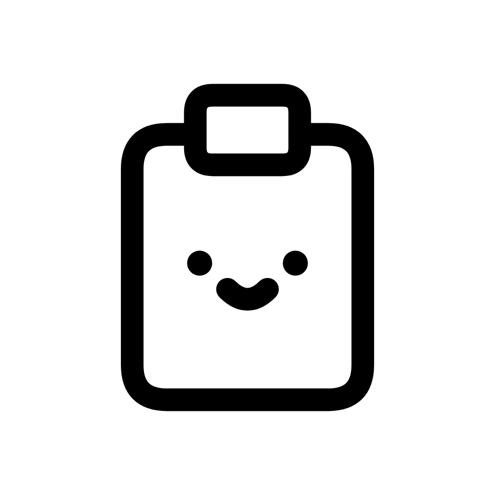

# heiccy



[한국어](README.md) · [English](README.en.md)


[](LICENSE)

> HEIC를 JPEG·PNG로, 알아서.
>
> 변환은 헤이키에게.

**heiccy**(헤이키)는 복사한 HEIC를 JPEG·PNG로 자동 변환해 **⌘V**로 붙여넣을 수
있도록 준비하는 macOS 메뉴바 앱입니다. Photos에서 사진을 복사하거나 Finder에서
HEIC 파일을 복사하면 됩니다. 사진은 내 컴퓨터에서 처리하고 원본 파일은 변경하지
않습니다.

앱과 변환 엔진 모두 Swift로 작성했으며 macOS 기본 이미지 기능을 사용합니다.
Python 런타임과 외부 코덱을 앱에 포함하지 않고, 따로 설치할 필요도 없습니다.

**배포 상태:** 앱 `1.0.0` 배포를 준비 중입니다. 공식 다운로드 진입점은
[heiccy Releases](https://github.com/jaehunshin-git/heiccy/releases)입니다.
릴리스가 공개된 뒤 해당 버전의 DMG를 받을 수 있습니다.

## 주요 기능

| 기능 | 설명 |
| --- | --- |
| 복사 후 자동 변환 | Photos의 지원하는 HEIC 사진이나 Finder의 로컬 HEIC 파일을 복사하고, 변환 완료 후 붙여넣습니다. |
| JPEG·PNG 선택 | JPEG 품질과 PNG 압축 수준을 설정하며, 지원하는 사진은 16비트 HDR PNG로 변환합니다. |
| 메타데이터 정책 | 기본 설정은 GPS·XMP를 제거합니다. 원본 정보 보존 또는 EXIF·XMP 제거도 선택할 수 있습니다. |
| 로컬 처리 | 사진을 서버로 보내지 않으며 원본 파일을 변경하거나 클립보드 이력을 저장하지 않습니다. |

## 기술 스택

| Category | 기술 |
| --- | --- |
| App | Swift, SwiftUI, AppKit |
| Conversion | macOS Image I/O, Core Image |
| Compression | macOS 시스템 zlib |

## macOS 앱 설치

### 요구 사항

- Apple Silicon Mac(arm64), macOS 15 이상
- Python·Pillow·추가 코덱 설치 불필요

### DMG 다운로드와 설치

앱 배포 경로는 [GitHub Releases](https://github.com/jaehunshin-git/heiccy/releases)입니다.
같은 공개 릴리스에서 DMG와 체크섬을 받습니다. 공개 릴리스가 준비되기 전에는
아래 절차를 소스에서 빌드한 앱·DMG에 적용할 수 있습니다.

1. 같은 빌드나 릴리스에서 DMG와 해당 `.sha256` 파일을 받습니다.
2. 두 파일이 있는 디렉터리에서 체크섬을 확인합니다.

   ```bash
   shasum -a 256 -c heiccy-1.0.0-arm64.dmg.sha256
   ```

3. DMG를 열고 **heiccy.app**을 **Applications**로 드래그합니다.
4. Applications에서 **heiccy**를 실행하면 메뉴바에 아이콘이 나타납니다.

현재 빌드는 ad-hoc 서명을 사용하며 공증하지 않습니다. 첫 실행이 차단되면
[Apple 공식 안내](https://support.apple.com/ko-kr/102445)를 따르세요.

### 기존 앱 빌드 교체

파일 이름이 달라 기존 `HEIC Converter.app`이 자동으로 교체되지는 않습니다.
이전 앱의 메뉴바 메뉴에서 먼저 종료해 앱이 게시한 클립보드를 복구할 수 있도록
합니다. 이전 앱 번들은 Applications 밖에 백업해 둔 뒤 `heiccy.app`을 설치하고
해당 앱을 직접 실행하세요. 두 앱을 함께 실행하지 마세요. 이전 빌드로 돌아갈 때도
heiccy를 먼저 종료합니다.

번들 ID와 설정 키를 유지하므로 저장한 변환 옵션과 레거시 출력 경로를 계속 읽습니다.
일시정지는 실행 중에만 유지하고 다음 실행에서는 자동 변환이 다시 켜집니다.

### 소스에서 앱 빌드

소스에서 앱을 빌드하려면 [앱 빌드·배포 안내](docs/build.md)를 참고하세요.

## heiccy 사용법

1. Photos에서 지원하는 HEIC 사진을 직접 복사하거나 Finder에서 로컬 HEIC 파일을
   복사합니다. 지원하는 Photos 사진은 별도로 내보낼 필요가 없습니다.
2. 변환 완료 알림을 기다립니다. 완료 전에 붙여넣으면 원본이 전달될 수 있습니다.
3. 대상 앱에서 **⌘V**로 붙여넣습니다.

| 조작 | 동작 |
| --- | --- |
| 메뉴바 아이콘 왼쪽 클릭 | 현재 클립보드 파일의 이름·썸네일·변환 상태를 표시하거나 숨깁니다. |
| 메뉴바 아이콘 오른쪽 클릭 | 자동 변환 일시정지·다시 시작, 설정 열기, 앱 종료를 제공합니다. |
| 설정 | JPEG·PNG 형식, 품질, 압축 수준과 메타데이터 정책을 고릅니다. |
| 실행 중인 앱을 Finder·Spotlight에서 다시 열기 | 클립보드 패널을 표시합니다. |

자동 변환은 앱을 실행할 때마다 켜집니다. 일시정지는 해당 실행에만 유지하고 변환
옵션은 저장합니다. 패널은 포커스가 다른 곳으로 이동하면 닫힙니다. 복사 감지만으로
패널을 열지 않으며 클립보드 이력은 저장하지 않습니다.

### 변환 설정

| 설정 | 동작 | 기본값 |
| --- | --- | --- |
| 출력 형식 | JPEG 또는 PNG | JPEG |
| JPEG 품질 | Low 60 · Medium 80 · High 90 · Raw 100. Raw도 손실 압축입니다. | High 90 |
| PNG 압축 | 0~9 수준의 사전 설정. 화질은 같고 변환 시간과 파일 크기가 달라집니다. SDR·HDR PNG 모두에 적용됩니다. | 6 |
| 메타데이터 | 안전 보존(`safe`) · 모두 보존(`preserve`) · 제거(`strip`) | 안전 보존 |

안전 보존은 GPS·XMP를 제거하고 나머지 EXIF를 가능한 범위에서 유지합니다.
모두 보존은 GPS를 포함한 EXIF·XMP를 가능한 범위에서 유지하고, 제거는 EXIF·XMP를
제외합니다. 어떤 정책이든 색 재현에 필요한 프로파일은 유지합니다.

지원하는 Apple HDR 게인 맵이 있고 방향 보정이 필요 없는 사진은 16비트 HDR PNG로
변환할 수 있습니다. 그 외의 PNG와 모든 JPEG는 SDR로 처리합니다. HDR 보존은
원본과 macOS 지원에 따라 달라집니다. 이미지 방향은 픽셀에 반영하며, PNG는 투명도를
유지하고 JPEG의 투명 영역은 흰색으로 채웁니다.

### 지원 입력과 클립보드 보호

- Photos가 클립보드에 제공한 HEIC 이미지와 읽을 수 있는 로컬 `.heic` 파일을
  지원합니다. Photos 보관함 내부 파일을 직접 읽거나 수정하지 않습니다.
- Photos 복사에 사용할 HEIC 원본 데이터가 없으면 변환할 수 없습니다. 원본이
  Mac에 내려받아진 사진을 다시 복사하세요. 계속 실패하면 수정하지 않은 원본을
  내보낸 뒤 Finder에서 복사하세요.
- 복사한 모든 HEIC의 변환이 성공했을 때만 클립보드를 교체합니다. 변환 중 새로
  복사하면 이전 결과로 덮어쓰지 않습니다. 혼합 항목의 순서는 유지합니다.
- 앱을 정상 종료하면 클립보드에 남아 있는 앱의 변환 결과를 원본으로 복구합니다.
  Photos 사진은 원본 HEIC 이미지로 복구하며, Photos 내부 참조 대신 임시 원본
  파일을 사용합니다. 같은 Photos 자산 선택 상태까지 복원하지는 않습니다.
  비정상 종료 후 복구는 보장하지 않습니다.
- 오프라인·읽기 불가 파일과 아직 파일이 준비되지 않은 복사 입력은 지원하지
  않습니다. HEIC의 대표 정지 이미지만 변환하며 Live Photo의 동영상은 처리하지
  않습니다. 안전하게 복구할 수 없는 혼합 입력은 클립보드를 교체하지 않습니다.
- 붙여넣기 지원은 대상 앱에 따라 달라집니다.

지원 입력과 수신 앱의 제한은 [클립보드 호환성](docs/compatibility.md)을 참고하세요.
사용 중 발견한 문제는 [heiccy 이슈](https://github.com/jaehunshin-git/heiccy/issues)에
접수할 수 있습니다.

## 배포와 문서

macOS 앱은 [GitHub Releases](https://github.com/jaehunshin-git/heiccy/releases)에서
배포합니다. Python CLI/TUI는 별도
[heic-converter-tui 저장소](https://github.com/jaehunshin-git/heic-converter-tui)에서
개발·배포합니다.

- [클립보드 호환성과 지원 범위](docs/compatibility.md)
- [앱 빌드·배포 안내](docs/build.md)
- [릴리스 노트](docs/releases/v1.0.0.md)
- [네이티브 앱 구성과 라이선스](docs/third-party-sources.md)
- [버그 신고·기능 제안](https://github.com/jaehunshin-git/heiccy/issues)

앱 자동 업데이트, Intel 지원, Homebrew Cask와 Mac App Store 배포는 제공하지 않습니다.
업데이트할 때 앱을 정상 종료한 뒤 새 DMG로 교체하세요.

## 라이선스

이 프로젝트는 [MIT 라이선스](LICENSE)를 따릅니다. 저작권 표시와 라이선스 전문을
포함하는 조건으로 사용, 복사, 수정, 배포 및 상업적 이용을 허용합니다. 소프트웨어는
어떠한 보증도 없이 제공되며, 자세한 조건은 [LICENSE](LICENSE)를 참고하세요.
앱은 macOS 기본 이미지 기능을 사용하며 Python이나 외부 코덱을 배포하지 않습니다.
앱의 MIT 전문과 구성 고지는 `Contents/Resources/Licenses`에서 확인할 수 있습니다.
